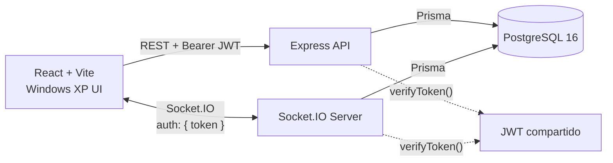

<div align="center">

# 💬 ChatRealTime

### Chat en tiempo real con alma de Windows XP

Un cliente de mensajería inspirado en **MSN Messenger** y **Windows XP**, con autenticación JWT compartida entre REST y WebSockets, persistencia en PostgreSQL y una interfaz retro construida desde cero.

[](https://react.dev/)
[](https://vite.dev/)
[](https://www.typescriptlang.org/)
[](https://expressjs.com/)
[](https://socket.io/)
[](https://www.prisma.io/)
[](https://www.postgresql.org/)
[](https://docs.docker.com/compose/)
[](#-licencia)

</div>

---

## ✨ Descripción

**ChatRealTime** es una aplicación full-stack de chat en vivo que combina un backend seguro y tipado con una experiencia visual nostálgica: ventanas Luna, taskbar, panel de temas y un cliente de mensajería que recuerda a MSN Messenger.

El proyecto demuestra un flujo de autenticación **JWT compartido**: el mismo token protege los endpoints REST y el handshake de Socket.IO, manteniendo una única fuente de identidad para HTTP y WebSockets.

---

## 🚀 Highlights

- **Autenticación unificada** — un solo JWT para REST y Socket.IO, verificado con la misma utilidad.
- **Salas en tiempo real** — listado, creación y selección de salas con `joinRoom` / `leaveRoom`.
- **Mensajería instantánea** — eventos `sendMessage` y `newMessage` con persistencia en PostgreSQL.
- **Diseño Windows XP** — tema Luna azul nativo de `xp.css`, variantes Plata y Oliva, y modo Custom con `hue-rotate()`.
- **Estado global persistido** — Zustand guarda sesión, usuario y tema en `localStorage`.
- **Seguridad de producción** — Helmet, rate limiting, validación estricta con Zod, bcrypt y CORS restringido.
- **Tipado estricto** — TypeScript con `strict`, `noUncheckedIndexedAccess` y chequeo de tipos limpio.
- **Infraestructura reproducible** — PostgreSQL 16 con Docker Compose y variables de entorno documentadas.

---

## 🧱 Stack

| Capa | Tecnología |
| --- | --- |
| Frontend | React 19, Vite 8, TypeScript |
| UI retro | `xp.css`, CSS personalizado, SVG propio |
| Estado global | Zustand + `persist` |
| HTTP client | Axios con interceptor JWT |
| Backend | Express 5, TypeScript |
| Tiempo real | Socket.IO 4 |
| ORM | Prisma 5 |
| Base de datos | PostgreSQL 16 |
| Autenticación | JWT (`jsonwebtoken`) + bcrypt |
| Validación | Zod 4 |
| Seguridad | Helmet + `express-rate-limit` |
| Infraestructura | Docker Compose |

---

## 🏗️ Arquitectura



### Autenticación compartida entre REST y WebSockets

1. `POST /api/auth/register` crea la cuenta con la contraseña hasheada con **bcrypt**.
2. `POST /api/auth/login` valida credenciales y firma un **JWT** con `id` y `role`.
3. El cliente guarda el token en Zustand (persistido en `localStorage`).
4. **REST:** el interceptor de Axios agrega `Authorization: Bearer <token>`; `verifyToken` valida la firma y expiración.
5. **WebSocket:** el cliente envía el token en `auth: { token }`; `socketAuthMiddleware` usa exactamente la misma función `verifyToken` y guarda la identidad en `socket.data.user`.
6. Las rutas protegidas y los eventos del socket comparten así una sola política de identidad.

---

## 🖥️ Interfaz Windows XP

- **Login** en una ventana modal clásica de XP con validación y mensajes de error en español.
- **Chat** con sidebar de salas, lista de contactos, barra de menú, status bar y composer.
- **Taskbar** con botón Inicio, reloj en vivo y panel de temas.
- **Temas:**
  - Azul Luna (nativo de `xp.css`)
  - Plata
  - Oliva
  - Custom con slider de tono (`hue-rotate`)
- **Responsive** para pantallas pequeñas.
- **Bloqueo condicional:** el composer permanece deshabilitado hasta seleccionar una sala.

---

## 📁 Estructura del proyecto

```text
ChatRealTime/
├── client/                      # Frontend Vite + React + TypeScript
│   ├── src/
│   │   ├── components/          # MsnLogo, RoomList, Taskbar, ThemePanel...
│   │   ├── screens/             # Login, ChatWindow
│   │   ├── services/            # Axios + interceptor JWT
│   │   ├── store/               # Zustand persistido
│   │   ├── styles/              # Temas XP (Plata, Oliva, Custom)
│   │   └── types/               # Tipos compartidos
│   └── .env.example
├── prisma/
│   └── schema.prisma            # User, Room, Message
├── src/
│   ├── controllers/             # auth, room
│   ├── middlewares/             # verifyToken REST, socket auth
│   ├── routes/                  # /api/auth, /api/rooms
│   ├── sockets/                 # Eventos de chat
│   ├── utils/                   # JWT compartido
│   └── server.ts                # Express + Helmet + rate limit + Socket.IO
├── docker-compose.yml           # PostgreSQL 16
├── .env.example
└── tsconfig.json
```

---

## ⚡ Quick start

### 1. Clonar e instalar

```bash
git clone https://github.com/<tu-usuario>/ChatRealTime.git
cd ChatRealTime
npm install
```

### 2. Configurar variables de entorno

```bash
cp .env.example .env
```

Editá `.env` y definí un `JWT_SECRET` largo y aleatorio. En Windows podés usar:

```powershell
Copy-Item .env.example .env
```

### 3. Levantar PostgreSQL

```bash
docker compose up -d
```

El contenedor expone PostgreSQL en `localhost:5432` y usa las credenciales de `.env`.

> Si ya tenés un PostgreSQL local, ajustá `DATABASE_URL` y omití este paso.

### 4. Sincronizar Prisma

```bash
npx prisma db push
```

### 5. Backend

```bash
npm run dev
```

API disponible en `http://localhost:3000`.

### 6. Frontend

En otra terminal:

```bash
cd client
npm install
npm run dev
```

Abrí `http://localhost:5173`.

---

## 🔐 Variables de entorno

### Backend (`.env`)

| Variable | Default | Descripción |
| --- | --- | --- |
| `NODE_ENV` | `development` | Entorno de ejecución |
| `PORT` | `3000` | Puerto del servidor Express |
| `CLIENT_ORIGIN` | `http://localhost:5173` | Origen permitido por CORS |
| `DATABASE_URL` | — | Cadena de conexión PostgreSQL |
| `JWT_SECRET` | — | Secreto de firma JWT (**obligatorio en producción**) |
| `JWT_EXPIRES_IN` | `1d` | Vida útil del token |
| `POSTGRES_USER` | `postgres` | Usuario de Docker Compose |
| `POSTGRES_PASSWORD` | `postgres` | Password de Docker Compose |
| `POSTGRES_DB` | `chatrealtime` | Base de datos de Docker Compose |

### Frontend (`client/.env`)

| Variable | Default | Descripción |
| --- | --- | --- |
| `VITE_API_URL` | `http://localhost:3000/api` | Base URL de la API REST |
| `VITE_SOCKET_URL` | `http://localhost:3000` | URL del servidor Socket.IO |

---

## 🌐 API REST

| Método | Endpoint | Auth | Descripción |
| --- | --- | --- | --- |
| `POST` | `/api/auth/register` | No | Registro con email y password (mín. 8 caracteres) |
| `POST` | `/api/auth/login` | No | Login; devuelve `token` y `user` |
| `GET` | `/api/health` | No | Health check del servidor |
| `GET` | `/api/rooms` | Bearer JWT | Lista todas las salas |
| `POST` | `/api/rooms` | Bearer JWT | Crea una sala con `{ "name": "..." }` |

Los cuerpos de autenticación se validan con **Zod** en modo estricto. Los errores devuelven `message` y un array `errors` con el detalle por campo.

---

## 🔌 Eventos Socket.IO

Handshake:

```ts
io("http://localhost:3000", {
  auth: { token: "<jwt>" },
});
```

| Evento | Dirección | Payload |
| --- | --- | --- |
| `joinRoom` | Cliente → Servidor | `roomId` |
| `leaveRoom` | Cliente → Servidor | `roomId` |
| `sendMessage` | Cliente → Servidor | `{ roomId, content }` |
| `newMessage` | Servidor → Cliente | Mensaje persistido |
| `error` | Servidor → Cliente | `{ message }` |

---

## 🛡️ Seguridad

- **Helmet** agrega cabeceras HTTP de seguridad.
- **Rate limiting** global: 300 requests / 15 min por IP.
- **Rate limiting de autenticación**: 20 intentos fallidos / 15 min por IP.
- **Zod** valida estrictamente los bodies de login y registro (sin campos extra).
- **bcrypt** con 10 rondas para almacenar contraseñas.
- **JWT** con expiración configurable; el servidor se niega a arrancar en producción sin `JWT_SECRET`.
- **CORS** limitado al origen configurado.
- **Body limit** de 16 KB para mitigar payloads abusivos.
- El **rol nunca se acepta desde el cliente**: Prisma aplica `USER` por defecto.

---

## 📜 Scripts

### Backend

| Comando | Descripción |
| --- | --- |
| `npm run dev` | Servidor con hot reload (`tsx watch`) |
| `npm start` | Servidor sin watch |
| `npm run typecheck` | Chequeo de tipos estricto |
| `npm run build` | Compila TypeScript a `dist/` |
| `npm run db:push` | Sincroniza el schema con PostgreSQL |
| `npm run db:studio` | Abre Prisma Studio |

### Frontend

| Comando | Descripción |
| --- | --- |
| `npm run dev` | Vite dev server |
| `npm run build` | Build de producción |
| `npm run lint` | Lint con Oxlint |
| `npm run preview` | Preview del build |

---

## 🗺️ Roadmap

- [ ] Historial de mensajes por sala (`GET /api/rooms/:id/messages`)
- [ ] Indicadores de escritura y presencia en tiempo real
- [ ] Mensajes leídos / no leídos
- [ ] Tests de integración para REST y Socket.IO
- [ ] CI/CD con GitHub Actions
- [ ] Deploy con Docker y reverse proxy

---

## 📄 Licencia

Distribuido bajo licencia **MIT**. Ver [`LICENSE`](LICENSE).

---

<div align="center">

Hecho con nostalgia de Windows XP, MSN Messenger y el sonido de un módem dial-up.

</div>
